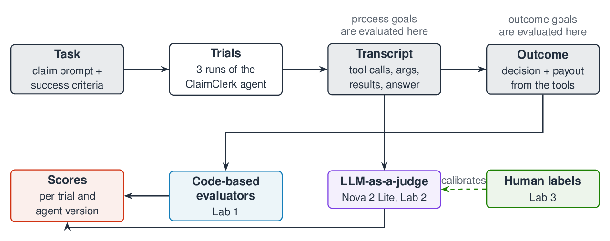

# Build an automated evaluation pipeline for AI agents

This repository accompanies a hands-on workshop on evaluating AI agents, first delivered at AWS re:Invent 2026 (Builder Session AIM351). In three Jupyter notebooks, plus two optional ones, you evaluate ClaimClerk, a health-benefits claims agent built with [Strands Agents](https://strandsagents.com) and Amazon Bedrock, and finish with a release gate that decides whether a changed version of the agent is safe to ship.

> **Note:** This sample is for educational use in a workshop and is not intended for production use.

## Overview

An agent reaches its answer through a sequence of model calls and tool calls, so checking only the final answer can miss an agent that reached the right number by skipping a required step. The labs evaluate both the answer and the steps that produced it, using transcripts of the agent that were captured before the session so that everyone in the room works on the same runs.

The labs use five terms from Anthropic's article [Demystifying evals for AI agents](https://www.anthropic.com/engineering/demystifying-evals-for-ai-agents). A **task** is one claim with a known correct decision and payout, and a **trial** is one run of the agent on that task. Each trial produces a **transcript**, which records the member's message, every tool call with its arguments and result, and the agent's final answer. The **outcome** is the decision and payout in that final answer, and a **grader** is a piece of code or a language model that scores one aspect of a transcript.



In Lab 1 you write graders in Python that compare each transcript with the known answer and with the tool calls the task requires. Lab 2 covers the qualities that code cannot check, such as whether a denial tells the member what to do next, by asking Amazon Nova 2 Lite to answer a written rubric about each transcript. In Lab 3 you measure how often that model judge agrees with human labels, revise the rubric where it disagrees, and combine the calibrated results with the code graders into a release gate.

## Labs

The notebooks are committed without cell outputs, so you see the results when you run the cells. Labs 1 to 3 run in the session, and Labs 4 and 5 are optional and self-paced.

### Lab 1: Code-based evaluators

Lab 1 builds outcome graders for the decision and the payout, and process graders that check which tools the agent called, in what order, and with which arguments. The graders are then combined into a weighted score with hard gates, where a hard gate is a grader that fails the whole trial on its own, such as a wrong payout. The lab ends by comparing pass@k, which counts a task as solved when any of its k trials passed, with pass^k, which requires all k trials to pass.

- [`Lab1_Code_Based_Evaluators.ipynb`](Lab1_Code_Based_Evaluators.ipynb)

### Lab 2: LLM-as-a-judge

Lab 2 writes a rubric of four yes or no questions about each transcript and sends it to Amazon Nova 2 Lite through the Amazon Bedrock Converse API. The judge returns a separate verdict and a written reason for each question. The request requires the judge to reply by calling a tool whose input schema lists the rubric questions, so every reply has the same structure and can be parsed without extra handling.

- [`Lab2_LLM_Judge.ipynb`](Lab2_LLM_Judge.ipynb)

### Lab 3: Judge calibration and release gate

Lab 3 compares the judge's verdicts with 60 human-labelled transcripts. It reports the share of human passes and human failures that the judge matched, along with Cohen's kappa, a measure of agreement that discounts the agreement two raters would reach by chance. After reading the disagreements you revise the rubric and measure agreement again, then build a regression gate that compares each changed version of the agent with the baseline and blocks a version that falls below a floor on any required score.

- [`Lab3_Judge_Calibration.ipynb`](Lab3_Judge_Calibration.ipynb)

The same checks are available on the command line in [`src/gate.py`](src/gate.py). Run `python -m src.gate v2-nova` from the repository root, and the script exits with code 1 when a check fails, so a CI build can stop a release. On the saved data the gate passes the Claude Haiku 5.5 version `v2-model` and the shorter-prompt version `v2-prompt`, and it blocks the Amazon Nova 2 Lite version `v2-nova` and the version without `check_coverage`, `v2-tools`.

### Lab 4 (optional): Change the agent and evaluate your version

Lab 4 applies the whole pipeline to a version of the agent that you define. You change the model, the system prompt or the tool list, run the changed agent live on 13 tasks, and evaluate the new traces with the Lab 1 evaluators, the calibrated `next_step` judge and the release gate. The default change adds two rules to the Nova 2 Lite version's system prompt, aimed at the decision and tool-call failures that Lab 3 found on TC-25, TC-26 and TC-27. In the saved run the rules fixed those three tasks, but the first rule also stopped the agent from calling `compute_payout` on TC-24, and the judge passed none of the version's denials on `next_step`, so the gate still blocked the version.

- [`Lab4_Optional_Change_and_Evaluate.ipynb`](Lab4_Optional_Change_and_Evaluate.ipynb)

### Lab 5 (optional): Evaluating with a decision model

Lab 5 introduces a third kind of grader, a decision model, using [Strands Decider](https://github.com/strands-labs/strands-decider). A decision model answers typed questions, such as a yes/no question, a choice among options or a score on a scale, with a confidence for each answer and without generating text, so it runs quickly on your own machine. The lab asks the model the Lab 2 rubric questions and compares its verdicts with the stored Nova 2 Lite judge verdicts and the human labels. It then builds a cascade in which the decision model settles the traces where its confidence is high and sends the rest to the Nova judge. The lab reads the Nova judge verdicts that Labs 2 and 3 stored, so it makes no Amazon Bedrock calls.

Lab 5 needs the optional `strands-decider` package, which is not a core dependency. Install it with `uv pip install ".[decider]"` and restart the kernel. The model is a checkpoint of about 2 billion parameters that downloads on first use and runs on a GPU, on an Apple-silicon Mac, or on the CPU. The notebook prints a message and skips its model cells when the package is not installed.

- [`Lab5_Optional_Strands_Decider.ipynb`](Lab5_Optional_Strands_Decider.ipynb)

## Getting started

At AWS-hosted events the environment is already set up, with the dependencies installed by [uv](https://docs.astral.sh/uv/) into a virtual environment in the `.venv` folder. Select the `.venv` kernel when a notebook asks for one.

To run the labs in your own environment you need Python 3.12 or later, uv, and [AWS credentials](https://docs.aws.amazon.com/cli/latest/userguide/cli-configure-files.html) that can call Amazon Bedrock in `us-east-1`. Install the dependencies from [pyproject.toml](pyproject.toml) with the following commands, then open the notebooks in VS Code or Jupyter with the `.venv` kernel.

```sh
uv venv --allow-existing
uv sync
```

The Lab 2 and Lab 3 judge calls use your default AWS Region, so set it to `us-east-1` in your AWS profile or with `export AWS_DEFAULT_REGION=us-east-1`. Your account needs access to the following models in Amazon Bedrock, all called through US cross-Region inference profiles:

| model | inference profile ID | needed for |
|---|---|---|
| Amazon Nova 2 Lite | `us.amazon.nova-2-lite-v1:0` | the judge in Labs 2 to 4 and the default agent in Lab 4 (required) |
| Claude Sonnet 5.5 | `us.anthropic.claude-sonnet-5-5` | the optional live agent run in Lab 1, one of the model swaps in Lab 4, and regenerating the traces |
| Claude Haiku 5.5 | `us.anthropic.claude-haiku-5-5` | one of the model swaps in Lab 4, and regenerating the traces |

The optional live agent cell in Lab 1 prints a message and continues when Claude Sonnet 5.5 is not available. Lab 4 runs the agent live throughout, so it needs access to the model you choose for your version. The judge calls in Labs 2 and 3 are required, so those labs need access to Amazon Nova 2 Lite even though most of their results are loaded from files.

## The agent and the data

ClaimClerk has four tools, `verify_member`, `fetch_policy`, `check_coverage` and `compute_payout`, which read the fictional members and plans in [`src/fixtures.py`](src/fixtures.py). The rules engine in [`src/rules.py`](src/rules.py) applies the same plan rules as the tools, and the correct decision, payout and expected tool route of every task were computed from it.

[`data/cases.json`](data/cases.json) holds the 27 tasks. Each task was run 3 times on each of 5 versions of the agent, which gives 405 trials. Each version except the baseline makes a change that a team might make to reduce cost or latency. Amazon Bedrock rejects the temperature parameter for Claude 5.x models, so the four Claude versions run at the model's default sampling and their three trials of a task can differ, while the Nova 2 Lite version runs at temperature 0.

| version | model | change from `v1` |
|---|---|---|
| `v1` | Claude Sonnet 5.5 | baseline |
| `v2-model` | Claude Haiku 5.5 | cheaper model, same prompt and tools |
| `v2-nova` | Amazon Nova 2 Lite | cheaper model, same prompt and tools |
| `v2-prompt` | Claude Sonnet 5.5 | shorter system prompt without the fixed tool procedure |
| `v2-tools` | Claude Haiku 5.5 | `check_coverage` removed, with the shorter system prompt |

`data/traces/<version>.jsonl` holds one transcript per line for each agent version.

The 60 labels in [`data/human_labels/reference_labels.jsonl`](data/human_labels/reference_labels.jsonl) give a verdict for each of the four rubric questions from Lab 2, an overall verdict, and a short rationale. They were written as reference labels for the session. Have someone with claims-adjudication experience review them before you use them to calibrate a judge outside the workshop.

`data/judge_verdicts/` holds the Amazon Nova 2 Lite judge verdicts for all 405 traces under the original rubric from Lab 2 and the revised rubric from Lab 3, so the labs do not have to judge every trace live.

## Cost and data safety

The three in-session labs make few Amazon Bedrock calls, because most results are loaded from the stored judge verdicts, and the calls they do make go to Amazon Nova 2 Lite. The optional live agent run in Lab 1 makes a handful of calls to Claude Sonnet 5.5. In the optional Lab 4, each task takes several model calls, because the agent calls its tools in turn, and the judge then makes one call for each trace. Lab 5 makes no Amazon Bedrock calls.

The members, plans and claims in this repository are fictional. Data of the same shape about real people, such as deductibles, coverage decisions, prior authorizations and claim payments, is Protected Health Information under HIPAA. If you adapt these labs to real claims data, put the required controls in place first, including a Business Associate Agreement with AWS and the use of [HIPAA eligible services](https://aws.amazon.com/compliance/hipaa-eligible-services-reference/), and follow the [AWS shared responsibility model](https://aws.amazon.com/compliance/shared-responsibility-model/).


## Layout

```
Lab1_Code_Based_Evaluators.ipynb ... Lab5_Optional_Strands_Decider.ipynb   the five lab notebooks
src/      the ClaimClerk agent, its fixture data and rules engine, the shared helpers, and gate.py
data/     tasks, captured traces, human labels and stored judge verdicts
images/   diagrams used in the notebooks
```

## Contributors

- Wale Akinfaderin
- Suyin Wang
- Sam Palani
- Dheeraj Hegde
- Aishwarya Gavili

## Acknowledgements

The ClaimClerk agent, its fixture data and tasks TC-01 to TC-14 are adapted from ClaimClerk, an agent evaluation demo built by a colleague at AWS. The terms task, trial, transcript, outcome and grader, and the pass@k and pass^k measures, follow Anthropic's [Demystifying evals for AI agents](https://www.anthropic.com/engineering/demystifying-evals-for-ai-agents).

## Security

See [CONTRIBUTING](CONTRIBUTING.md#security-issue-notifications) for more information.

## License

This library is licensed under the MIT-0 License. See the [LICENSE](LICENSE) file.
